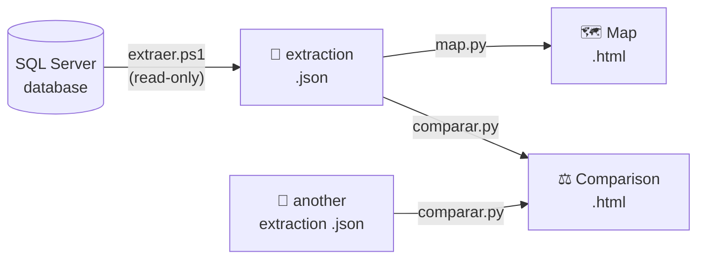

<div align="center">

 # SQL-Lens
 
**Dependency maps for SQL Server databases.**<br>
*If I change this, what breaks?*
 


 
</div>

 
## The idea
 
SQL-Lens shows **what depends on each table, view, procedure or function** of a SQL Server database, so you know what breaks before you change it.
 
It was built at work, out of a real need: knowing the impact of a change, and spotting the differences between environments (for example, DEV and PRO).
 
> 📄 **The result is a single `.html` file** that opens with a double click.
> Search for any object and see its dependencies. Nothing else to install.

 
## What it does
 
| | |
|---|---|
| 📥 **Extract** | Reads the structure of a database (server + database) and saves it as a `.json`. **It never touches table data or changes anything.** |
| 🗺️ **Map** | Turns an extraction into a searchable dependency map. |
| ⚖️ **Compare** | Compares two extractions: how many objects of each type each one has, which exist only in A or only in B, and which differ. |
| 💾 **Save as HTML** | Writes the map or the comparison to a file to share it. |

 
## How it works
 

 
- **The extraction runs with PowerShell**, so it also works on the VMs where the database lives, with nothing to install.
- **The map is a snapshot.** Whenever the database changes (new procedure, new table, altered code...), extract again and regenerate the map.
- **Tables are compared by their columns**, and whitespace differences are ignored.


## The app
 
Double-click **`SQL-Lens.exe`**. Nothing to install: the extraction runs `extraer.ps1` with PowerShell, so it also works on the VMs.
 
| Button | What you pick | What you get |
|---|---|---|
| **EXTRACT** | Server and database | The `.json` saved in `extractions/` |
| **MAP** | An extraction | The map opens in the window |
| **COMPARE** | Two extractions | The comparison opens in the window |
 
*Save as HTML* writes the map or comparison to `maps/` or `comparisons/` to share it.

 
## Build the .exe
 
<details>
<summary>How to build <code>SQL-Lens.exe</code></summary>
<br>
`SQL-Lens.exe` is not in the repository: build it once, and again after any change to the code.
 
```bash
pip install pyinstaller pillow pywebview
.\build_exe.bat
```
 
It writes `SQL-Lens.exe` with the icon (`icon.ico`), the screens and `extraer.ps1` inside. Copy just the `.exe` to any machine: it creates its `extractions/` folder next to itself.
 
</details>

## From the command line
 
<details>
<summary>Extract, map and compare without the app</summary>
<br>
The map is a snapshot. **Whenever the database changes**, repeat steps 1 to 3.
 
**1. On the VM: extract**
 
In the folder where `extraer.ps1` is:
 
```bash
powershell -ExecutionPolicy Bypass -File .\extraer.ps1 -Server localhost -Databases MESDB
```
 
It writes `extraction_<server>_MESDB_<date>.json`. It never touches table data or changes anything.
 
**2. Copy the `.json` to the `extractions/` folder** on your machine.
 
**3. On your machine: map**
 
```bash
python map.py --from extraction_<server>_MESDB_<date>.json
```
 
It writes `maps/map_<server>_MESDB_<date>.html`. Open it and search for any object.
 
**4. Compare two databases**
 
Extract each one (step 1, on each server) and run:
 
```bash
python comparar.py extraction_DEV_MESDB_<date>.json extraction_PRO_MESDB_<date>.json
```
 
It writes `comparisons/compare_<A>_vs_<B>_<date>.html`.
 
</details>

## Structure
 
```
extractions/   the .json files copied from the servers
maps/          the generated maps
comparisons/   the generated comparisons
```
 
<div align="center">
<sub>Project by <a href="https://github.com/XesusPatino">@XesusPatino</a></sub>
</div>
