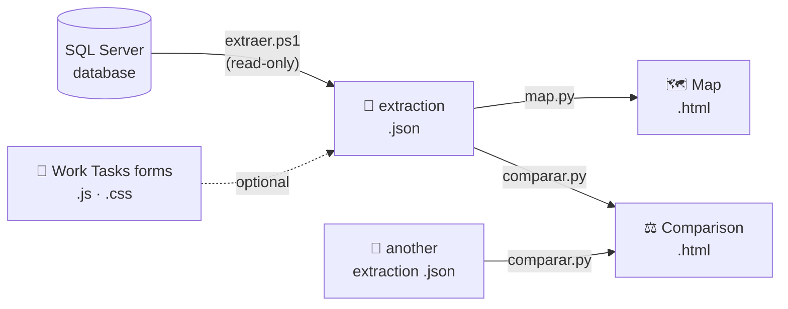

<div align="center">

 # SQL-Lens
 
**Dependency maps for SQL Server databases.**<br>
*If I change this, what breaks?*
 


 
</div>

 
## The idea
 
SQL-Lens shows **what depends on each table, view, procedure or function** of a SQL Server database, so you know what breaks before you change it.
 
It was built at work, out of a real need: knowing the impact of a change, and spotting the differences between environments (for example, DEV and PRO).

It can also read the **JavaScript of the AVEVA Work Tasks forms**, to see which procedures and lookups each form calls.
 
> 📄 **The result is a single `.html` file** that opens with a double click.
> Search for any object and see its dependencies. Nothing else to install.

 
## What it does
 
| | |
|---|---|
| 📥 **Extract** | Reads the structure of a database (server + database) and saves it as a `.json`. Optionally, also the `.js` and `.css` of the forms. **It never touches table data or changes anything.** |
| 🗺️ **Map** | Turns an extraction into a searchable dependency map. |
| 🔎 **Filter by type** | Shows only one type of object (procedures, JavaScript files, lookups…): in the map and in the list of differences of a comparison. |
| ⚖️ **Compare** | Compares two extractions: how many objects of each type each one has, which exist only in A or only in B, and which differ (also the `.js` and `.css`). |
| 💾 **Save as HTML** | Writes the map or the comparison to a file to share it. |

 
## How it works
 

 
- **The extraction runs with PowerShell**, so it also works on the VMs where the database lives, with nothing to install.
- **The map is a snapshot.** Whenever the database changes (new procedure, new table, altered code...), extract again and regenerate the map.
- **Tables are compared by their columns**, and whitespace differences are ignored.
- **The JavaScript is read, not run.** Calls like `MESDirectAccess("GET", "sp_name", …)` and `getLookupSchemaAndData("MyLookup", …)` become links, also when the name is in a variable (`var lookupName = "MyLookup"`). If the name is built at run time, the map warns that some calls may be missing.


## Filter by type
 
In the map, next to the search box, choose a type of object (tables, procedures, JavaScript files, lookups…). It shows how many there are of each.
 
- The **search** only finds that type.
- The **start page** lists all the objects of that type, the most used first.
- On an object, the **list of what a change affects** shows only that type, and *Copy list for Excel* copies it. In the drawing, the other types are dimmed: they are still needed to follow the path.
 
In a comparison, the same filter is next to *Filter by name*: the list of differences and its counts show only that type.


## The app
 
Double-click **`SQL-Lens.exe`**. Nothing to install: the extraction runs `extraer.ps1` with PowerShell, so it also works on the VMs.
 
> On a machine without WebView2 (some Windows Servers) the app opens in Microsoft Edge. Where the `.exe` cannot be used (for example, if the antivirus blocks it), extract with `extraer.ps1` instead.
 
| Button | What you pick | What you get |
|---|---|---|
| **EXTRACT** | Server and database | The `.json` saved in `extractions/`, in the folder of its kind |
| **MAP** | An extraction | The map opens in the window |
| **COMPARE** | Two extractions | The comparison opens in the window |
 
*Save as HTML* writes the map or comparison to `maps/` or `comparisons/` to share it.
 
In **Extract**, the optional **Web files** box adds the `.js` and `.css` of the forms. By default, the `NextGenForms\js` and `NextGenForms\css` folders of Work Tasks, with their `custom` subfolders. They are read on the machine where SQL-Lens runs, so run it on the VM.
 
Each kind of extraction is saved in its own folder, so you only compare extractions of the same kind:
 
| Kind | Server · Database | Web files | Saved in |
|---|---|---|---|
| Database only | `localhost` · `MESDB` | not ticked | `extractions/extractions_db/` |
| With web files | `localhost` · `MESDB` | ticked | `extractions/extractions_wf/` |
 
In **Map** and **Compare**, the extractions are grouped by kind.

 
## Build the .exe
 
<details>
<summary>How to build <code>SQL-Lens.exe</code></summary>
<br>
`SQL-Lens.exe` is not in the repository: build it once, and again after any change to the code.
 
```bash
pip install pyinstaller pillow pywebview
.\build_exe.bat
```
 
It writes `SQL-Lens.exe` with the icon (`assets/icon.ico`), the screens and `extraer.ps1` inside. Copy just the `.exe` to any machine: it creates its `extractions/` folder next to itself.
 
</details>

## From the command line
 
<details>
<summary>Extract, map and compare without the app</summary>
<br>
The map is a snapshot. **Whenever the database changes**, repeat steps 1 to 3.
 
**1. On the VM: extract**
 
In the folder where `extraer.ps1` is (from `cmd` or PowerShell), one command for each kind of extraction. `-Server` is `localhost` on the database VM, or the server you connect to in SSMS (`server` or `server\instance`).
 
*Database only:*
 
```bash
powershell -ExecutionPolicy Bypass -File .\extraer.ps1 -Server localhost -Databases MESDB
```
 
*With web files* (`-Web`: the folders of the `.js` and `.css`, read on the machine where you run it):
 
```bash
powershell -ExecutionPolicy Bypass -File .\extraer.ps1 -Server localhost -Databases MESDB -Web "C:\Program Files\AVEVA\Work Tasks\Web\BPMUITemplates\Default\NextGenForms\js","C:\Program Files\AVEVA\Work Tasks\Web\BPMUITemplates\Default\NextGenForms\css"
```
 
It writes `extraction_<server>_<databases>_<date>.json`, with `_wf` before the date when it has web files. It never touches table data or changes anything.
 
**2. Copy the `.json` to the folder of its kind** on your machine:
 
| Example of name | Folder |
|---|---|
| `extraction_<server>_MESDB_20261104.json` | `extractions/extractions_db/` |
| `extraction_<server>_MESDB_wf_20261104.json` | `extractions/extractions_wf/` |
 
**3. On your machine: map**
 
```bash
python map.py --from extraction_<server>_MESDB_<date>.json
```
 
It finds the file in the `extractions/` folders, and writes `maps/map_<server>_MESDB_<date>.html` (with `_wf` if the extraction has it). Open it and search for any object.
 
**4. Compare two databases**
 
Extract each one with the same kind of extraction (step 1, on each server) and run:
 
```bash
python comparar.py extraction_DEV_MESDB_<date>.json extraction_PRO_MESDB_<date>.json
```
 
It writes `comparisons/compare_<A>_vs_<B>_<date>.html` (with `_wf` if A has it).
 
</details>

## Structure
 
```
extractions/
  extractions_db/      database only
  extractions_wf/      + web files (.js, .css)
maps/                  the generated maps
comparisons/           the generated comparisons
```
 
<div align="center">
<sub>Project by <a href="https://github.com/XesusPatino">@XesusPatino</a></sub>
</div>
